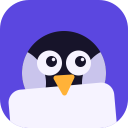

<p align="center">
  
</p>

<h1 align="center">Jackdaw</h1>

<p align="center">Learn any dataset. Local-first, with an open pack format that people, scripts and chatbots can write.</p>

<p align="center"><a href="https://orellbuehler.github.io/jackdaw/">Website</a> · <a href="https://orellbuehler.github.io/jackdaw/privacy.html">Privacy</a> · <a href="https://orellbuehler.github.io/jackdaw/support.html">Support</a></p>

Jackdaw is a spaced-repetition learning app for Android and iOS. You learn from **packs**: single JSON files that hold anything you can ask a question about, such as vocabulary, history facts, exam questions or interview preparation. Packs have an [open, documented format](format/README.md), so a chatbot can write one for you in a minute.

Your data stays on your devices: no account of ours, no analytics, no servers, no network code in the shared core (the Android app does not even request the internet permission). The iOS app can sync through **your own private iCloud** (CloudKit private database, on by default, switch in Settings): packs, review history and the goal settings are then also stored there and shown on all your Apple devices. Only the owner of the iCloud account can read them, and nothing is ever sent anywhere else. Android is local-only.

## Features

- **Seven item types**: flashcards (one or both directions), multiple choice, short typed answers, cloze (fill the gaps), true/false, ordering and open questions with a self-graded key point checklist.
- **Spaced repetition**: an SM-2 family scheduler tracks every card direction separately. Learn mode asks what is due and introduces new items; practice mode drills any items (mixed, flashcards, quiz or typing) without changing the schedule.
- **Stats**: daily goal, streak, accuracy and an activity history.
- **Easy to add content**: open a `.jackdaw` file (also from Files, Mail or a chat), paste text, pick from the bundled sample library, or use "Create with AI" to copy a ready-made chatbot prompt.
- **Pack updates keep your progress**: importing a newer revision of a pack keeps the progress on items that still exist ([spec section 4.2](format/README.md#42-updating-a-pack)).
- **iCloud sync on iOS**: the same packs, progress and goals on every device signed in to the same iCloud account. Two devices that study offline merge their reviews instead of overwriting each other ([how it works](shared/README.md#sync)).
- **English and German**, light and dark theme.
- **One core, two native UIs**: all logic lives in a Kotlin Multiplatform module; the apps are Jetpack Compose (Android) and SwiftUI (iOS).

## The pack format

A pack is one UTF-8 JSON file (`.jackdaw`, media type `application/vnd.jackdaw.pack+json`).

- Required: `format` (`"jackdaw-pack"`), `version` (`1`), `id` (stable and unique), `title`, and a non-empty `items` array.
- Optional: `description`, `language`, `author`, `license`, `tags`, `icon`, `color`, `revision`, `sections` (chapters) and `study` (order, new items per session, reversible cards, ...).
- Every item has a unique `id` and a `type`: `card`, `choice`, `text`, `cloze`, `truefalse`, `order` or `open`. It may also have a `section`, a `hint` (shown before answering) and an `explanation` (shown after).
- Text is plain with `**bold**`, `*italic*` and `` `code` ``. Cloze gaps are written `{{answer}}`, with an optional hint `{{answer::hint}}` and alternatives `{{colour|color}}`.
- Progress is not part of a pack. It is kept by the app, keyed by pack `id` and item `id`.
- Writers are strict, readers are forgiving: the app skips what it cannot use, imports the rest and tells you what it skipped.

```json
{
  "format": "jackdaw-pack",
  "version": 1,
  "id": "pack.capitals.9c41ab",
  "title": "Capitals",
  "language": "en",
  "items": [
    { "id": "france", "type": "card", "front": "France", "back": "Paris", "reversible": true },
    { "id": "largest-ocean", "type": "text", "question": "Which is the largest ocean?", "answers": ["Pacific", "Pacific Ocean"] },
    { "id": "berlin-wall", "type": "cloze", "text": "The Berlin Wall fell in {{1989::year}}." }
  ]
}
```

- [`format/README.md`](format/README.md): the normative specification (format version 1, draft)
- [`format/AUTHORING.md`](format/AUTHORING.md): guide for AI assistants and tool authors
- [`format/prompt.txt`](format/prompt.txt): the copy-paste chatbot prompt
- [`format/jackdaw-pack.schema.json`](format/jackdaw-pack.schema.json): JSON Schema 2020-12
- [`format/examples/`](format/examples/): sample packs (also bundled in the app); [`format/validate.py`](format/validate.py) and [`format/test-vectors.json`](format/test-vectors.json) check packs and readers

## Create a pack with any chatbot

1. In the app choose **Add pack**, then **Create with AI**, and copy the prompt. (It is the same text as [`format/prompt.txt`](format/prompt.txt).)
2. Paste it into any chatbot and fill in the placeholders: topic or your own notes, language, level and number of items.
3. Paste the chatbot's answer back into Jackdaw, or save it as `something.jackdaw` and open it. The import preview shows what will be added and lists any problems.

To check a pack on a computer first: `pip install jsonschema`, then `python3 format/validate.py my-pack.jackdaw`.

## Project structure

| Path | Content |
|---|---|
| `shared/` | Kotlin Multiplatform core: pack reader, scheduler, study sessions, SQLDelight storage. Entry point `JackdawSdk`; reference in [`shared/README.md`](shared/README.md). On iOS it is the `shared` framework (via SKIE). |
| `androidApp/` | Android app: Jetpack Compose and Material 3. |
| `iosApp/` | iOS app: SwiftUI. The Xcode project is generated from `project.yml` with XcodeGen. Only `iosApp/Jackdaw/SDK/` talks to `shared`; the CloudKit sync layer is `SDK/Sync/`, its schema `cloudkit/schema.ckdb`. |
| `format/` | The pack format: specification, schema, validator, test vectors, authoring guide, examples. |
| `brand/` | Logo and symbol (SVG). |
| `scripts/ios/` | Helpers for the iOS release job and the CloudKit schema check. |
| `.github/` | CI and release workflows, the iOS runner setup action, Dependabot. |

## Build

### Android

Requirements: JDK 17 and the Android SDK (set `ANDROID_HOME` or `sdk.dir` in `local.properties`). `compileSdk` is 37, `minSdk` is 26.

```sh
./gradlew androidApp:assembleDebug        # debug APK in androidApp/build/outputs/apk/debug/
./gradlew shared:allTests                 # shared module tests (the iOS test targets only run on macOS)
./gradlew androidApp:testDebugUnitTest    # Android unit tests
./gradlew androidApp:lintDebug            # Android lint
./gradlew shared:ktlintCheck androidApp:ktlintCheck
python3 format/validate.py --strict       # pack format checks (needs: pip install jsonschema)
```

### iOS

Requires macOS with Xcode, JDK 17 and [XcodeGen](https://github.com/yonaskolb/XcodeGen) (`brew install xcodegen`). The deployment target is iOS 18. These are the steps CI runs:

```sh
./gradlew shared:linkDebugFrameworkIosSimulatorArm64

SDK_NAME=$(xcrun --sdk iphonesimulator --show-sdk-version)
DEST="shared/build/xcode-frameworks/Debug/iphonesimulator${SDK_NAME}"
mkdir -p "$DEST"
cp -R shared/build/bin/iosSimulatorArm64/debugFramework/shared.framework "$DEST/"

cd iosApp
xcodegen generate
xcodebuild build \
  -project Jackdaw.xcodeproj \
  -scheme Jackdaw \
  -destination 'generic/platform=iOS Simulator' \
  -configuration Debug \
  CODE_SIGNING_ALLOWED=NO \
  ARCHS=arm64
```

`ARCHS=arm64` because the staged framework is the arm64 simulator slice. The Kotlin/Native tests of the shared module run with `./gradlew shared:iosSimulatorArm64Test`. To run the app, open `iosApp/Jackdaw.xcodeproj` after the steps above.

## iCloud sync (iOS)

The app syncs with a CKSyncEngine over one zone (`JackdawZone`) of the private CloudKit database of the container `iCloud.ch.orellbuehler.jackdaw`. There is no server of ours. The merge logic is in `shared/` ([`shared/README.md`](shared/README.md#sync)); the Swift side is a thin layer in `iosApp/Jackdaw/SDK/Sync/`.

- **What is synced**: imported packs (including their content), the whole review history (schedules are rebuilt from it, so two devices that studied offline lose nothing), deleted packs (as tombstones, so another device cannot bring them back), the daily goal and the session size. **Stays on the device**: the theme and the welcome tour.
- **Privacy**: the data goes into the user's private iCloud database, which only the account holder can read. It is not accessible to the developer, and nothing else leaves the device.
- **Where the controls are**: Settings has an "iCloud sync" card with an on/off switch, the last sync time, why sync is unavailable (no account, restricted, account changed, ...), a "Sync now" button and the last error in full (CloudKit error code and message). The app keeps working offline and without iCloud; changes wait in a local queue.
- **Simulator and CI**: sync is disabled on the simulator, in unit tests and in SwiftUI previews, because an unsigned build has no iCloud entitlement and touching CloudKit would trap. The entitlements (`iosApp/Jackdaw/Jackdaw.entitlements`) are applied to device builds only.

### Deploy the CloudKit schema (once, and after every change to the records)

TestFlight and App Store builds use the CloudKit **production** environment, where record types are not created on the fly. `iosApp/cloudkit/schema.ckdb` describes the three record types (`Pack`, `ReviewLog`, `Setting`). CI checks that it matches the code (`scripts/ios/check-cloudkit-schema.py`). To deploy it from a browser:

1. Open the [CloudKit Console](https://icloud.developer.apple.com/dashboard/) and choose the container `iCloud.ch.orellbuehler.jackdaw`.
2. Switch to the **Development** environment, open **Schema** and choose **Import Schema...**, then pick `iosApp/cloudkit/schema.ckdb`. Check that `Pack`, `ReviewLog` and `Setting` are listed under Record Types.
3. Choose **Deploy Schema Changes...** (development to production) and confirm. Afterwards the same three record types must be visible in the **Production** environment.

With a Mac, `xcrun cktool import-schema --team-id <TEAM_ID> --container-id iCloud.ch.orellbuehler.jackdaw --environment development --file iosApp/cloudkit/schema.ckdb` does step 2 (needs a CloudKit management token). Record types and fields cannot be removed or renamed in production, only added.

Before the first sync build also make sure the App ID `ch.orellbuehler.jackdaw` has **iCloud (CloudKit)** with the container `iCloud.ch.orellbuehler.jackdaw` assigned, and **Push Notifications**, and that the App Store profile `Jackdaw App Store` was regenerated after that (the release job compares the profile with `Jackdaw.entitlements` and stops with a clear message otherwise).

## Continuous integration

| Workflow | Runs on | What it does |
|---|---|---|
| `android.yml` | pull requests and pushes to `main`, manual | ktlint, shared module build, debug APK (uploaded as artifact), Android lint, shared and Android unit tests, informational Kover coverage. `android-gate` is the always-reporting required check. |
| `ios.yml` | pull requests and pushes to `main`, manual | `ios-build` (CloudKit schema check, shared framework and simulator app build, the fast compile signal), then `ios-tests` (Kotlin/Native tests of `shared`). `ios-gate` is the always-reporting required check. |
| `release.yml` | published GitHub release, manual dispatch | Signed release builds, see below. |

The iOS jobs run on GitHub's `xcode-27` image with the Xcode 27.0 GM pinned and verified by `.github/actions/ios-setup`. Dependabot proposes weekly Gradle and GitHub Actions updates (Kotlin is bumped by hand together with SKIE).

## Release

Every store build belongs to a [GitHub release](https://github.com/OrellBuehler/jackdaw/releases): publishing a release (tag such as `v1.0.0`) runs `release.yml`, and the tag is the version in both stores. Starting the workflow by hand from the Actions tab (inputs: `version`, and `platforms` = both, android or ios) only retries a platform of a release that already exists; it fails for a version without a published release. The version must look like `1.2.3` or `v1.2.3`.

- **Versions**: the tag without `v` is the Android `versionName` and the iOS `MARKETING_VERSION`. The workflow run number is the iOS build number and is folded into the Android `versionCode` (`(major*10000 + minor*100 + patch) * 1000 + run number`), so re-runs always increase.
- **Android job**: builds a signed AAB and APK, uploads both as workflow artifacts, attaches them to the GitHub release as `jackdaw-<version>.apk` and `.aab`, and uploads the AAB to the Google Play internal testing track when `GOOGLE_PLAY_SERVICE_ACCOUNT_JSON` is set.
- **iOS job**: checks the stored provisioning profile (including the iCloud container and production push), builds the shared release framework, archives with App Store Connect API key cloud signing, removes the development certificates that cloud signing created, exports with manual signing (Apple Distribution certificate and the stored profile), verifies the signature and the exported entitlements (iCloud, CloudKit, `aps-environment` = `production`) and uploads to TestFlight. The IPA is kept as workflow artifact.

A job whose required secrets are missing fails in its first step and names them. No repository variables are used.

| Secret | Job | Content |
|---|---|---|
| `ANDROID_KEYSTORE_BASE64` | Android | The signing keystore, base64 on one line: `base64 -w0 release.jks \| gh secret set ANDROID_KEYSTORE_BASE64` |
| `ANDROID_KEYSTORE_PASSWORD` | Android | Keystore password |
| `ANDROID_KEY_ALIAS` | Android | Key alias in the keystore |
| `ANDROID_KEY_PASSWORD` | Android | Password of that key |
| `GOOGLE_PLAY_SERVICE_ACCOUNT_JSON` | Android, optional | Play Console service account JSON (plain text). Without it the Play upload is skipped. The app must exist in the Play Console first; a brand-new app may refuse the `completed` release status, then do the first upload by hand. |
| `APP_STORE_CONNECT_API_KEY_BASE64` | iOS | The `.p8` App Store Connect API key (role Admin or App Manager): `openssl base64 -A -in AuthKey_XXXXXXXXXX.p8 \| gh secret set APP_STORE_CONNECT_API_KEY_BASE64` |
| `APP_STORE_CONNECT_KEY_ID` | iOS | Key ID of that API key |
| `APP_STORE_CONNECT_ISSUER_ID` | iOS | Issuer ID of the App Store Connect account |
| `APPLE_TEAM_ID` | iOS | Apple developer team ID (injected into `iosApp/ExportOptions.plist` during the job) |
| `IOS_DIST_CERT_P12_BASE64` | iOS | Apple Distribution certificate with private key, exported as `.p12`, base64 on one line |
| `IOS_DIST_CERT_PASSWORD` | iOS | Password of the `.p12` |
| `IOS_PROFILE_APP_BASE64` | iOS | App Store provisioning profile for `ch.orellbuehler.jackdaw`, base64 on one line: `openssl base64 -A -in Jackdaw_App_Store.mobileprovision \| gh secret set IOS_PROFILE_APP_BASE64` |

One-time iOS setup: register the App ID `ch.orellbuehler.jackdaw`, create the app in App Store Connect, and create the App Store provisioning profile with the exact name `Jackdaw App Store` (the name `iosApp/ExportOptions.plist` refers to). The profile must include iCloud (CloudKit) with the app's container and Push Notifications (see "iCloud sync"). If the app gains capabilities later, regenerate the profile and update the secret.

## Status

MVP. The shared core and the Android app are built and tested in CI. The iOS app has not been compiled yet: the `ios.yml` run is the first compile gate, so expect build fixes on the first run.

No licence has been chosen yet, so nothing in this repository is licensed for reuse for now.
